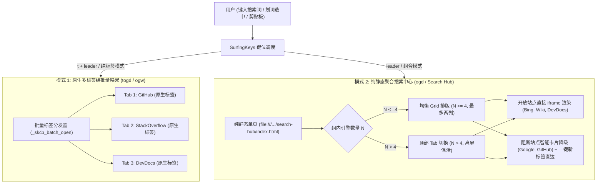

# 自定义多引擎聚合搜索与原生标签组调度

本文档介绍 SurfingKeys Configuration Builder (SKCB) 的**轻量级零守护进程（Zero-Sidecar）聚合搜索方案**。

本方案结合了**“SurfingKeys 原生多标签批量调度”**与**“纯静态多视口聚合中心（Search Hub）”**，彻底摒弃本地 Node.js 反代进程与常驻服务，实现 100% 即开即用、零运维损耗。

---

## 1. 核心特性与架构模式



### 1.1 为什么选择零 Sidecar 方案？
- **零后台开销**：无需启动任何 Node.js 服务或本地反代端口，所有核心逻辑均在 SurfingKeys 编译后的 `surfingkeys.js` 与纯静态 HTML 中完成。
- **登录态与隐私安全**：原生标签页完整继承浏览器已有 Cookie、GitHub / Google 账号登录态与 uBlock 去广告扩展拦截，杜绝本地网络中转安全隐患。
- **自适应视口排版**：严格执行用户界面规范：
  - $\le 4$ 引擎：最多两列的均衡自适应 Grid（1 屏 100%、2 屏对称 50%/50%、3 屏上二下一、4 屏 2x2 四宫格）。
  - $> 4$ 引擎：顶部 Tab 标签栏，采用 CSS 离屏保活机制（`visibility: hidden; transform: translateY(-99999px)`），切屏 0ms 且保留页面滚动与交互状态。

---

## 2. 配置文件规范 (`profile.searchGroups`)

在 Profile JSON（如 [`profiles/developer.json`](../profiles/developer.json)）中，添加 `searchGroups` 数组：

```json
{
  "schemaVersion": 1,
  "id": "developer",
  "extends": "./common.json",
  "searchGroups": [
    {
      "id": "dev",
      "name": "Developer Search",
      "leader": "ogd",
      "mode": "both",
      "layout": "auto",
      "engines": [
        "upstream/search-engines.ddg",
        {
          "name": "DevDocs",
          "url": "https://devdocs.io/#q={query}",
          "canIframe": true
        },
        {
          "name": "GitHub",
          "url": "https://github.com/search?q={query}&type=code",
          "canIframe": false
        },
        {
          "name": "StackOverflow",
          "url": "https://stackoverflow.com/search?q={query}",
          "canIframe": false
        }
      ]
    },
    {
      "id": "web",
      "name": "Web Multi-Search",
      "leader": "ogw",
      "mode": "tabs",
      "engines": [
        "bing",
        "wikipedia",
        "duckduckgo"
      ]
    }
  ]
}
```

### 字段说明

| 字段 | 类型 | 说明 | 默认值 |
| :--- | :--- | :--- | :--- |
| `id` | `string` | 组唯一标识符（字母、数字、下划线、中划线） | **必填** |
| `name` | `string` | 搜索组名称，显示在 Omnibar 与聚合页面顶栏 | **必填** |
| `leader` | `string` | 触发键位（如 `ogd`, `ogw`） | `og` + `id[0]` |
| `mode` | `"both" \| "tabs" \| "hub"` | 调度模式：<br>• `both`: 默认打开聚合页，提供专用批量新标签键；<br>• `tabs`: 划选文本时直接后台打开所有标签；<br>• `hub`: 仅打开静态聚合页 | `"both"` |
| `layout` | `"auto" \| "grid" \| "tabs"` | 排版模式：`auto` 会在 $\le 4$ 时自动网格，$> 4$ 时自动 Tab | `"auto"` |
| `engines` | `Array<string \| object>` | 引擎列表：支持内置别名、Catalog ID、或自定义对象 | **必填** |
| `hubUrl` | `string` | 自定义聚合 HTML 文件路径或 URL | 本地 `file:///.../search-hub/index.html` |

### 引擎定义支持三种形式：
1. **Catalog Feature ID**：如 `"upstream/search-engines.ddg"`，自动解析其实际检索模板与名称；
2. **内置常用引擎简写**：如 `"google"`, `"bing"`, `"github"`, `"stackoverflow"`, `"wikipedia"`, `"devdocs"`, `"mdn"`, `"hackernews"`；
3. **自定义引擎对象**：
   ```json
   {
     "name": "DevDocs",
     "url": "https://devdocs.io/#q={query}",
     "canIframe": true
   }
   ```

---

## 3. 键位操作与快捷工作流

为每个搜索组自动生成以下三层阶梯式按键映射：

| 快捷键 | 功能 | 说明 |
| :--- | :--- | :--- |
| **`ogd`** (leader) | **智能搜索 / 聚合调度** | • 若当前网页有划选文字：直接带入搜索词；<br>• 若无划选文字：弹出 SurfingKeys Omnibar 键入搜索词；<br>• 在 `both` 模式下进入聚合中心，在 `tabs` 模式下直达标签组。 |
| **`cogd`** (`c` + leader) | **剪贴板搜索** | 自动读取剪贴板内容作为检索词并调起搜索。 |
| **`togd`** (`t` + leader) | **瞬时批量新标签后台打开** | **无需打开任何聚合页面**，立即将当前划选词或剪贴板词带入所有引擎，在后台打开 $N$ 个浏览器标签页，首个标签自动聚焦，其余后台加载。 |

---

## 4. 纯静态聚合搜索中心 (Search Hub)

静态页面位于 [`ui/search-hub/index.html`](../ui/search-hub/index.html)（构建产物同步位于 `dist/search-hub/index.html`）：

1. **直接双击运行**：支持任意浏览器通过 `file:///` 协议直接打开，或托管至 GitHub Pages、内网静态主机。
2. **开放站原生嵌套**：对支持 iframing 的站点（DevDocs、Bing、Wikipedia、HackerNews 等）直接多屏并排渲染。
3. **阻断站优雅降级**：对包含 `X-Frame-Options: SAMEORIGIN` 或 CSP `frame-ancestors` 的受保护站点（Google、GitHub、StackOverflow），渲染品牌专属卡片，并提供“在新标签页打开”操作。
4. **全局一键动作**：
   - 顶部快捷搜索框（按 `/` 快速聚焦，按 `Esc` 失焦）；
   - “全部打开”按钮：一键在新标签页中批量打开当前组的所有引擎结果；
   - “自动弹出阻断站”开关：勾选后在聚合搜索时自动静默在新标签页弹出被保护站点，兼顾并排查看与无缝浏览；
   - 数字键 `1`..`9`：在 Tab 模式下瞬间切屏。
